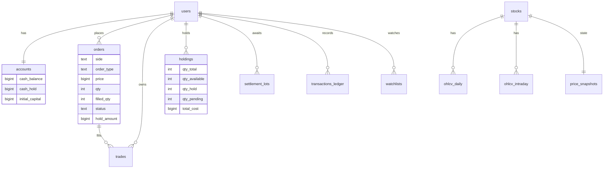

# VNStock Sim — Sàn chứng khoán Việt Nam mô phỏng

Web chứng khoán đầy đủ chức năng ở chế độ **giao dịch ảo (paper trading)**: bảng giá realtime HOSE/HNX/UPCOM, biểu đồ nến chuyên nghiệp, đặt lệnh LO/MP/ATO/ATC, khớp lệnh theo sổ lệnh, phí, thuế, thanh toán T+2, danh mục và sao kê.
Giao diện tham khảo **SSI iBoard** (màu bảng điện VN) và **Binance** (bố cục terminal giao dịch, nền tối, typography).

> ⚠️ Mặc định toàn bộ giá, chỉ số và thông tin doanh nghiệp là **dữ liệu giả lập** phục vụ học tập. Có thể bật **giá thật** (bảng giá + nến ngày HOSE/HNX/UPCOM) bằng `MARKET_PROVIDER=vnstock` — xem [Dữ liệu thị trường thật](#dữ-liệu-thị-trường-thật-vnstock). Dù dùng nguồn nào, giao dịch đều bằng vốn ảo và không phải khuyến nghị đầu tư.

## Tính năng

| Trang | Nội dung |
|---|---|
| **Bảng giá** (`/`) | 4 thẻ chỉ số (VN-Index, VN30, HNX, UPCOM) có sparkline + độ rộng thị trường; bảng điện 3 bước giá mua/bán, khớp lệnh, tổng KL, cao/thấp, khối ngoại; nháy ô khi giá đổi; tab VN30/HOSE/HNX/UPCOM/Theo dõi, lọc ngành, tìm mã, sắp xếp cột |
| **Giao dịch** (`/trade/:symbol`) | Header mã (TC/trần/sàn/mở/cao/thấp/KL/GT/NN); biểu đồ nến TradingView 1m→1M + MA20/MA50 + volume + đường tham chiếu; sổ lệnh có thanh độ sâu (bấm giá để điền form); băng khớp lệnh realtime; form đặt lệnh (sức mua, tối đa, 25/50/75/100%, phí, thuế, xác nhận); lệnh chờ / sổ lệnh / danh mục / hồ sơ doanh nghiệp; sửa & huỷ lệnh |
| **Thị trường** (`/market`) | Biểu đồ chỉ số trong ngày/3T/1N/tất cả; độ rộng từng sàn; **heatmap treemap** theo ngành (diện tích = vốn hoá); top tăng/giảm/GTGD/khối ngoại; hiệu suất ngành |
| **Tài sản** (`/portfolio`) | NAV, tiền mặt, sức mua, phong toả, lãi/lỗ chưa & đã thực hiện, phí, thuế; bảng danh mục (khả dụng / chờ về T+2 / chờ bán); donut phân bổ; khớp gần đây; đặt lại tài khoản |
| **Lịch sử** (`/history`) | Lịch sử lệnh, lịch sử khớp (kèm tổng hợp lãi/lỗ), sao kê tiền; lọc ngày/mã/chiều/trạng thái; phân trang; xuất CSV |
| **Đăng nhập / Đăng ký** | Mở tài khoản nhận 1 tỷ vốn ảo; nút "tài khoản demo" có sẵn danh mục; đổi mật khẩu |

Thêm: giao diện **tối/sáng**, responsive mobile, thông báo khớp lệnh realtime, đồng hồ & trạng thái phiên.

## Công nghệ

- **Frontend**: React 18 + Vite + TypeScript + Tailwind CSS v4, React Router, TanStack Query, Zustand, Socket.io client, TradingView Lightweight Charts v5, lucide-react, sonner
- **Backend**: Node.js + Express + TypeScript (tsx), Socket.io, Zod, JWT + bcrypt, helmet, rate limit
- **CSDL**: PostgreSQL nhúng **PGlite** (chạy ngay, không cần cài đặt) — schema SQL chuẩn, chuyển sang Supabase/Postgres thật được
- **Chung**: package `@vss/shared` chứa quy tắc nghiệp vụ, kiểu dữ liệu và schema validate dùng cho cả FE và BE

## Chạy nhanh

Yêu cầu Node.js ≥ 20.

```bash
npm install
cp backend/.env.example backend/.env   # rồi đổi JWT_SECRET
npm run dev
```

- Web: http://localhost:5173 · API: http://localhost:4000
- Lần chạy đầu tự tạo dữ liệu: 92 mã, ~500 phiên lịch sử, 4 chỉ số và một tài khoản demo (email/mật khẩu nằm trong `backend/.env.example`). Ở trang đăng nhập có nút **"Trải nghiệm nhanh với tài khoản demo"**.
- Xoá thư mục `backend/data` để tạo lại dữ liệu từ đầu.

Các lệnh khác:

```bash
npm test            # unit test bộ khớp lệnh, quy tắc giá, map dữ liệu thật (vitest)
npm run test:data-service   # unit test chuẩn hoá dữ liệu của data-service (Python)
npm run typecheck   # kiểm tra kiểu FE + BE
npm run build       # build frontend production
```

## Cấu hình (`backend/.env`)

| Biến | Mặc định | Ý nghĩa |
|---|---|---|
| `MARKET_MODE` | `SIMULATED_24_7` | `SIMULATED_24_7`: thị trường chạy liên tục; `REAL_HOURS`: theo giờ HOSE (ATO 9:00–9:15, liên tục, nghỉ trưa 11:30–13:00, ATC 14:30–14:45) |
| `MARKET_PROVIDER` | `mock` | `mock`: giá giả lập; `vnstock`: giá thật qua data-service (nên dùng cùng `MARKET_MODE=REAL_HOURS`) |
| `VNSTOCK_URL` | `http://127.0.0.1:8001` | Địa chỉ data-service |
| `VNSTOCK_POLL_MS` | `3000` | Chu kỳ lấy bảng giá trong khung 8:30–15:05 (ngoài giờ: mỗi phút) |
| `VNSTOCK_STALE_MS` | `20000` | Quá thời gian này không lấy được dữ liệu thật → tự chuyển sang giả lập |
| `VNSTOCK_HISTORY_DAYS` | `500` | Số phiên nến ngày nạp từ nguồn ở lần đầu |
| `VNSTOCK_MAX_RPM` | `120` | Giới hạn số request backend gửi tới data-service mỗi phút |
| `SETTLEMENT_DAYS` | `2` | Số ngày thanh toán T+N. Đặt `0` để bán được ngay sau khi mua (tiện test) |
| `TICK_INTERVAL_MS` | `1000` | Chu kỳ cập nhật giá |
| `JWT_SECRET` | — | Khoá ký token, đặt chuỗi ngẫu nhiên dài |
| `DATA_DIR` | `./data/pgdata` | Nơi lưu CSDL |
| `DEMO_EMAIL` / `DEMO_PASSWORD` | demo | Tài khoản demo được seed (để trống để tắt) |

## Dữ liệu thị trường thật (vnstock)

Backend có 2 nguồn dữ liệu cài đặt cùng interface `MarketDataProvider` ([`backend/src/market/types.ts`](backend/src/market/types.ts)):

- **`MockProvider`** — giả lập (mặc định).
- **`RealProvider`** ([`backend/src/market/vnstock`](backend/src/market/vnstock)) — lấy bảng giá thật định kỳ từ **data-service** (FastAPI, thư mục [`data-service/`](data-service)).

Chạy (cần Python ≥ 3.10):

```bash
# trong backend/.env:  MARKET_PROVIDER=vnstock  và  MARKET_MODE=REAL_HOURS
npm run data-service:setup   # lần đầu: tạo data-service/.venv, cài fastapi + uvicorn + httpx
npm run dev:vnstock          # data-service :8001 + API :4000 + web :5173
```

Hoặc chạy riêng `npm run data-service` rồi `npm run dev`. Khi đang hiển thị giá thật, header có nhãn **"Giá thật"**; khi chạy giả lập là **"Giả lập"**. `GET /api/health` trả thêm `provider` và `feed` (`LIVE`/`SIM`).

**Nguồn dữ liệu.** data-service gọi trực tiếp API công khai của VCI (trading.vietcap.com.vn) — chính là nguồn mặc định mà thư viện Python [vnstock](https://github.com/thinh-vu/vnstock) dùng, miễn phí, không cần key. Không cài gói `vnstock` vì dự án này trên PyPI đang ở trạng thái *quarantined* (không tải được). Muốn đổi nguồn chỉ cần sửa `data-service/app/vci.py` + `normalize.py`, schema trả cho backend giữ nguyên.

| Endpoint data-service | Nội dung | Cache |
|---|---|---|
| `GET /board?symbols=FPT,HPG,…` | Bảng giá: TC/trần/sàn, mở/cao/thấp/khớp, KL & GT luỹ kế (khớp lệnh), 3 bước giá mua/bán, giá khớp ATO/ATC, khối ngoại, KL niêm yết | 2 giây |
| `GET /history?symbols=FPT,VNINDEX&days=500` | Nến ngày cổ phiếu và chỉ số (`VNINDEX`, `VN30`, `HNXINDEX`, `UPCOMINDEX`) | 30 phút |
| `GET /indices` | Giá trị 4 chỉ số (nến ngày gần nhất) | 10 giây |
| `GET /health` | Trạng thái nguồn, số request tới nguồn trong 1 phút | — |

data-service giới hạn ≤ 120 request/phút tới nguồn (`UPSTREAM_RPM`) và gộp các request trùng; backend chỉ gửi 1 request bảng giá mỗi `VNSTOCK_POLL_MS` (≈ 20 request/phút trong giờ giao dịch, 1 request/phút ngoài giờ).

**Cách RealProvider dùng dữ liệu thật**

- Lần đầu chạy (hoặc khi CSDL đang chứa lịch sử giả lập) nạp ~500 phiên nến ngày thật cho 92 mã + 4 chỉ số, thay toàn bộ lịch sử giả lập; các lần sau chỉ tải bù vài phiên (đánh dấu trong bảng `market_meta`). KL niêm yết cũng cập nhật theo nguồn.
- Khởi động giữa phiên: đồng bộ thẳng trạng thái hiện tại của nguồn, không mô phỏng phần phiên đã qua. Sau đó mỗi lần KL luỹ kế tăng Δ → 1 giao dịch Δ tại giá khớp cuối (vẽ nến 1 phút, băng khớp lệnh, khớp lệnh LO của người dùng); tổng GT luôn khớp với nguồn.
- Sổ lệnh lấy từ nguồn. Lệnh người dùng "ăn" thanh khoản thì phần đã ăn được trừ khỏi các bản cập nhật sau cho tới khi mức giá đó rời sổ lệnh.
- ATO/ATC: không sinh KL giả; lệnh ATO/ATC của người dùng khớp theo giá khớp thật khi nguồn công bố (chờ tối đa 30 giây).
- TC/trần/sàn theo nguồn (đã điều chỉnh khi có quyền); VN-Index, VN30, HNX-Index, UPCOM-Index lấy giá trị thật.
- **Tự chuyển về giả lập** khi data-service lỗi hoặc quá `VNSTOCK_STALE_MS` không có dữ liệu (mô phỏng tiếp từ giá thật hiện tại); khi nguồn có lại thì đồng bộ về giá thật. Với `MARKET_MODE=SIMULATED_24_7`, ngoài giờ giao dịch (kể cả nghỉ trưa) cũng chạy giả lập.

**Giới hạn**: chỉ 92 mã trong danh mục seed (độ rộng thị trường, tổng KL/GT trên thẻ chỉ số tính theo rổ này); tên, ngành, EPS/BVPS vẫn là số liệu seed; nến 1 phút chỉ có từ lúc server chạy; dữ liệu trễ vài giây; API của VCI là API web không chính thức nên có thể thay đổi. Khi chuyển một CSDL đang dùng giả lập sang `vnstock`, nên xoá `backend/data` để danh mục/giá vốn của tài khoản cũng theo giá thật.

## Quản trị & vận hành

- Trang **Quản trị** (`/admin`, chỉ hiện với tài khoản quản trị viên) gồm 6 mục: Tổng quan · Người dùng · Lệnh giao dịch · Vận hành thị trường · Dữ liệu & sao lưu · Nhật ký.
- Tài khoản quản trị đầu tiên được tạo lúc khởi động từ `ADMIN_EMAIL` / `ADMIN_PASSWORD` (giá trị mẫu cho dev nằm trong `backend/.env.example`; khi `NODE_ENV=production` bắt buộc tự đặt).
- Quản trị viên có thể: tạo / khoá / mở khoá / xoá tài khoản, cấp hoặc thu quyền, điều chỉnh vốn ảo, đặt lại tài khoản, huỷ hộ lệnh, tạm ngừng nhận lệnh (toàn hệ thống hoặc theo mã), đăng thông báo hệ thống, khai báo ngày nghỉ lễ, tải bản sao lưu JSON, xem nhật ký quản trị và log máy chủ. Mọi thao tác đều được ghi vào bảng `admin_audit_log`.
- Trang pháp lý mẫu: `/dieu-khoan`, `/chinh-sach-bao-mat` (bản demo, cần luật sư rà soát trước khi dùng thật).
- Khảo sát chịu tải (máy chủ local đang chạy): `npm run loadtest -w backend -- --users 30 --orders 20`. Báo cáo JSON được ghi vào `backend/data/loadtest-*.json`. Với PGlite đo được khoảng 26–33 thao tác lệnh / giây; chạy nhiều người dùng thật thì nên dùng PostgreSQL.

## Quy tắc nghiệp vụ

Định nghĩa trong [`shared/src/index.ts`](shared/src/index.ts) (cần đối chiếu quy định hiện hành nếu dùng cho mục đích khác):

- Biên độ: HOSE ±7%, HNX ±10%, UPCOM ±15% — trần làm tròn xuống, sàn làm tròn lên theo bước giá
- Bước giá HOSE: < 10.000 → 10đ; 10.000–49.950 → 50đ; ≥ 50.000 → 100đ. HNX/UPCOM: 100đ
- Lô chẵn 100 CP; tối đa 500.000 CP/lệnh (HOSE), 1.000.000 (HNX/UPCOM)
- Loại lệnh: HOSE `LO/MP/ATO/ATC`, HNX `LO/MP/ATC`, UPCOM `LO`
- Phí 0,15% mỗi chiều, thuế TNCN 0,1% khi bán; giá vốn bao gồm phí mua
- Lệnh mua phong toả `giá × KL + phí` (MP/ATO/ATC phong toả theo giá trần); lệnh bán phong toả cổ phiếu
- Lệnh MP quét tối đa 3 bước giá, phần dư chuyển thành LO cao/thấp hơn 1 bước giá; không có đối ứng thì huỷ
- Cuối phiên, lệnh chưa khớp hết hiệu lực và được giải phóng phong toả
- Không bán khống, không margin. Tiền dùng số nguyên VNĐ (BIGINT), mọi thay đổi tiền/CP nằm trong 1 transaction có khoá dòng

## Kiến trúc

```
MockProvider ──poll()──▶ MarketService ──events──▶ Socket.io ──▶ React (Zustand store)
 (giá giả lập)     ▲     │ trạng thái giá, nến 1m,        board / indices / trades / candle
RealProvider ──────┘     │
 │ (giá thật, tự về Mock khi lỗi)
 └─HTTP─▶ data-service (FastAPI) ──▶ VCI
                         │ chỉ số, phiên, rollover ngày
                         └─hooks──▶ TradingEngine ──▶ PGlite (PostgreSQL)
                                    đặt/sửa/huỷ, khớp lệnh, T+2      ▲
Express REST /api/* ─────────────────────────────────────────────────┘
```

- **Nguồn dữ liệu**: chọn bằng `MARKET_PROVIDER` (`createProvider` trong `backend/src/index.ts`). Muốn thêm nguồn khác (SSI FastConnect, DNSE…) chỉ cần cài đặt `MarketDataProvider` hoặc thay phần gọi nguồn trong data-service.
- **Đổi sang Supabase**: chạy `backend/migrations/*.sql` trên Supabase và thay lớp `Database` trong `backend/src/db.ts` bằng client `pg` (giao diện `many/one/exec/tx` giữ nguyên).

### Sơ đồ dữ liệu



## API

| Method | Đường dẫn | Mô tả |
|---|---|---|
| POST | `/api/auth/register` · `/login` · `/demo` | Đăng ký / đăng nhập / tài khoản demo → `{ token, user }` |
| GET | `/api/auth/me` · POST `/api/auth/change-password` | Thông tin / đổi mật khẩu |
| GET | `/api/market/session` · `/stocks` · `/stocks/:symbol` · `/indices` | Phiên, bảng giá, chi tiết mã (kèm khớp gần nhất), chỉ số |
| GET | `/api/market/stocks/:symbol/candles?tf=1m\|5m\|15m\|1h\|1D\|1W\|1M` | Nến |
| GET | `/api/market/indices/:code/history?tf=1m\|1D` | Lịch sử chỉ số |
| GET | `/api/account` · `/api/portfolio` · POST `/api/account/reset` | Tài khoản, danh mục, đặt lại |
| GET/POST | `/api/orders?scope=open\|today\|all` | Danh sách / đặt lệnh |
| PATCH/DELETE | `/api/orders/:id` | Sửa / huỷ lệnh |
| GET | `/api/trades` · `/api/ledger` | Lịch sử khớp, sao kê (lọc `from`, `to`, `symbol`, `side`) |
| GET/POST/DELETE | `/api/watchlist` | Danh sách theo dõi |

Socket.io: `board`, `indices`, `session` (mọi client); `trades`, `candle` (sau khi `symbol:subscribe`); `order`, `fill`, `account` (riêng người dùng, xác thực bằng `auth.token`).

## Cấu trúc thư mục

```
vnstock-sim/
├─ data-service/              FastAPI lấy bảng giá + nến ngày thật (app/vci.py, app/normalize.py, tests/)
├─ shared/src/index.ts        quy tắc giá, kiểu, schema zod dùng chung
├─ backend/
│  ├─ migrations/001_init.sql
│  ├─ src/market/             MockProvider, MarketService (giá, nến, chỉ số, phiên); vnstock/ = RealProvider
│  ├─ src/trading/            TradingEngine (khớp lệnh, phong toả, T+2), DTO
│  ├─ src/routes/             auth, market, trading
│  ├─ src/seed/               danh sách mã, sinh lịch sử, tài khoản demo
│  └─ test/                   vitest
└─ frontend/src/
   ├─ pages/                  Board, Trade, Market, Portfolio, History, Auth
   ├─ components/             board, trade, chart, market, portfolio, layout, common
   ├─ store/                  zustand (market, auth, ui/ticket)
   └─ hooks/ lib/             realtime socket, api, queries, format
```
